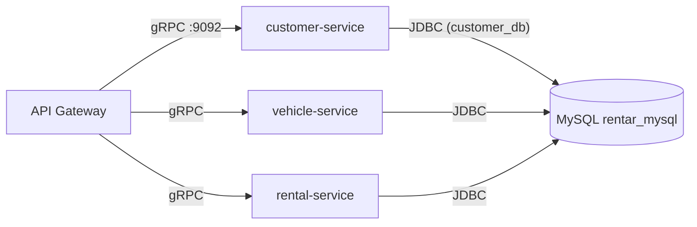

# customer-service

Microservicio gRPC de gestión de clientes y autenticación para el sistema de **Empresa Rentar**, correspondiente a la tarea **H2-4** de la migración del TP de Sistemas Distribuidos desde el monolito REST/GraphQL del Hito 1 (`web_services`) hacia la arquitectura distribuida basada en gRPC del Hito 2.

## Índice

1. [Descripción general y arquitectura](#descripción-general-y-arquitectura)
2. [Tecnologías utilizadas](#tecnologías-utilizadas)
3. [Estructura del proyecto](#estructura-del-proyecto)
4. [Requisitos previos y configuración](#requisitos-previos-y-configuración)
5. [Instalación y ejecución](#instalación-y-ejecución)
6. [Funciones RPC expuestas](#funciones-rpc-expuestas)
7. [Seguridad y autenticación](#seguridad-y-autenticación)
8. [Decisiones técnicas](#decisiones-técnicas)

---

## Descripción general y arquitectura

`customer-service` expone, vía **gRPC puro en el puerto 9092**, la lógica de negocio de clientes, usuarios y autenticación que en el Hito 1 vivía dentro del monolito `web_services` (REST + GraphQL). No tiene UI ni expone HTTP público para su lógica de negocio: su único punto de entrada funcional es el contrato definido en [`proto/customer.proto`](../proto/customer.proto).

Dentro del ecosistema distribuido del TP, este servicio es consumido por el **API Gateway** (capa que sí habla HTTP/REST hacia el frontend y traduce esas llamadas a gRPC hacia los microservicios), y convive con `vehicle-service` y `rental-service`, cada uno dueño de su propio dominio y su propio esquema de base de datos, pero compartiendo el mismo contenedor MySQL (`rentar_mysql`) levantado desde el `docker-compose.yml` raíz del repositorio.



Puntos clave de la arquitectura:

- El servicio **no valida JWT por su cuenta**: confía en que el Gateway ya validó el token y le propaga la identidad resultante (roles y subject) como metadata gRPC (`roles`, `sub`). Esta decisión está documentada como **ADR-001** en el código (`GrpcSecurityConfig`).
- La política de seguridad es **fail-closed**: todo método gRPC sin una regla explícita es rechazado (`denyAll()`), incluidos los RPC que el proto define pero que el servicio todavía no implementa.
- El HTTP embebido (Tomcat, puerto propio vía `CUSTOMER_SERVER_PORT`) sigue activo únicamente como remanente de la base de código heredada del Hito 1 (Swagger/GraphQL quedaron configurados en `application.properties`), pero **la superficie funcional de H2-4 es exclusivamente gRPC**.

## Tecnologías utilizadas

| Tecnología | Uso en este servicio |
|---|---|
| **Java 21** | Lenguaje y versión de la JVM (`java.version=21` en el `pom.xml`). |
| **Spring Boot 4.1.1** | Framework base (`spring-boot-starter-parent`). |
| **Spring gRPC** (`spring-boot-starter-grpc-server`) | Servidor gRPC Netty autoconfigurado; descubre los beans `@GrpcService` y expone reflection/health. |
| **Spring Security** (`spring-boot-starter-security`) | Base del modelo de autorización fail-closed, extendido para gRPC vía `GrpcSecurity`/`AuthenticationProcessInterceptor`. |
| **Spring Data JPA** + **MySQL** (`mysql-connector-j`) | Persistencia de `Cliente`, `Usuario`, `Rol`, `UsuarioRol`, `TokenBlacklist`. |
| **jjwt 0.11.5** (`jjwt-api`/`jjwt-impl`/`jjwt-jackson`) | Emisión y parseo de JWT en `JwtService` (misma versión que el monolito `web_services`, por compatibilidad de API). |
| **Lombok** | Reducción de boilerplate (constructores, getters/setters) en entidades, DTOs y servicios. |
| **spring-dotenv** | Carga del archivo `.env` propio del módulo vía `spring.config.import=optional:file:.env[.properties]`. |
| **protobuf-maven-plugin** (`io.github.ascopes`) | Genera en build los stubs Java a partir de `proto/customer.proto` (carpeta compartida con el resto de los microservicios). |
| **springdoc-openapi** | Swagger UI, heredado del Hito 1; no forma parte del contrato H2-4. |
| **spring-boot-devtools** | Recarga automática en desarrollo local. |

## Estructura del proyecto

Paquetes principales bajo `src/main/java/com/rentar/customer_service/`:

| Paquete | Responsabilidad |
|---|---|
| `grpc` | Adapter gRPC: `CustomerGrpcServiceImpl` (implementación de `CustomerServiceGrpc.CustomerServiceImplBase`) y los mappers puros `CustomerGrpcMapper` / `AuthGrpcMapper` que traducen entre DTOs de la capa de servicio y mensajes protobuf. No contiene lógica de negocio. |
| `config` | `GrpcSecurityConfig`: única fuente de verdad de la política de autorización gRPC (fail-closed, extracción de metadata `roles`/`sub`). |
| `service` / `service.impl` | Lógica de negocio reutilizada y extendida del Hito 1: `IClienteService`/`ClienteServiceImpl`, `IAuthService`/`AuthServiceImpl`, `JwtService`, `IUsuarioService`, `IUsuarioRolService`, `IRolService`, `ITokenCleanupService`. |
| `repository` | Repositorios Spring Data JPA: `IClienteRepository`, `IUsuarioRepository`, `IUsuarioRolRepository`, `IRolRepository`, `ITokenBlacklistRepository`. |
| `exception` / `exception.custom` | `GrpcGlobalExceptionHandler` (mapeo de excepciones de dominio a `Status` gRPC, ver sección 7), `GlobalExceptionHandler` (handler HTTP heredado del Hito 1, sin uso en el contrato gRPC) y las excepciones de dominio (`ClienteNotFoundException`, `BadRequestException`, `ResourceNotFoundException`, `DniAlreadyExistsException`, `EmailAlreadyExistsException`, `RolNotFoundException`). |
| `model` | Entidades JPA: `Cliente`, `Usuario`, `Rol`, `UsuarioRol`/`UsuarioRolId`, `TokenBlacklist`. |
| `dto.request` / `dto.response` | DTOs de entrada/salida de la capa de servicio (`ClienteRequestDTO`, `ClienteUpdateDTO`, `ClienteResponseDTO`, `AuthResponseDTO`, `ErrorResponseDTO`). |
| `mapper` | `ClienteMapper`: traduce entre `Cliente` (entidad) y los DTOs de servicio. |
| `validation` | `MayorDeEdadValidator` + anotación `@MayorDeEdad`, reutilizados tal cual del Hito 1. |
| `enums` | `NombreRol` (roles de dominio: `ADMINISTRADOR`, `CLIENTE`). |

## Requisitos previos y configuración

### Requisitos

- JDK 21.
- Maven Wrapper incluido (`./mvnw` / `mvnw.cmd`), no requiere instalación de Maven.
- MySQL disponible: se reutiliza el servicio `mysql-db` del `docker-compose.yml` ubicado en la raíz del repositorio (contenedor `rentar_mysql`), en un esquema propio (`customer_db`) distinto del esquema del monolito (`rentar_db`).

### Variables de entorno

El servicio lee su configuración desde un archivo `.env` **propio del módulo** (`customer-service/.env`, no versionado), distinto del `.env` de la raíz del repositorio. Variables requeridas:

| Variable | Descripción |
|---|---|
| `CUSTOMER_SERVER_PORT` | Puerto HTTP de Spring (Swagger/Actuator; no es el puerto gRPC). |
| `DB_HOST` | Host de MySQL (`localhost` para desarrollo local contra el contenedor mapeado). |
| `DB_PORT` | Puerto de MySQL (`3306`). |
| `CUSTOMER_DB_NAME` | Nombre del esquema propio de este servicio (`customer_db`). |
| `DB_USERNAME` / `DB_PASSWORD` | Credenciales de MySQL. Se usa el usuario `root` del contenedor porque el usuario de aplicación del monolito (`rentar_user`) no tiene privilegios para crear un esquema nuevo (`createDatabaseIfNotExist=true`). |
| `SPRING_JPA_HIBERNATE_DDL_AUTO` | Estrategia de Hibernate para el esquema (`update`). |
| `JWT_SECRET` | Secreto de firma JWT. Se usa el mismo valor que el monolito a los fines de esta prueba local; no existe aún validación cruzada de JWT entre servicios (ver ADR-001 en la sección de Seguridad). |
| `JWT_EXPIRATION` | Tiempo de expiración del JWT, en milisegundos. |
| `GRPC_CUSTOMER_SERVER_PORT` | Puerto del servidor gRPC Netty (**9092**). Si no está definida, `application.properties` aplica el default `9092` (`spring.grpc.server.port=${GRPC_CUSTOMER_SERVER_PORT:9092}`). |

## Instalación y ejecución

Desde la raíz del repositorio (`TPDistribuidos/`):

```bash
# 1. Levantar MySQL (una sola vez, compartido con el resto de los microservicios)
docker compose up -d mysql-db
```

Desde `customer-service/`:

```bash
# 2. Compilar (regenera los stubs gRPC a partir de proto/customer.proto)
./mvnw clean compile

# 3. Levantar el microservicio
./mvnw spring-boot:run
```

Al iniciar correctamente, los logs confirman:

- Tomcat escuchando en `CUSTOMER_SERVER_PORT` (HTTP, heredado del Hito 1).
- Servidor gRPC Netty escuchando en el puerto **9092**.
- Registro de los servicios gRPC: `rentar.customer.CustomerService`, `grpc.reflection.v1.ServerReflection`, `grpc.health.v1.Health`.

### Verificación rápida (smoke test)

Sin instalar `grpcurl` localmente, puede usarse la imagen oficial de Docker apuntando al host:

```bash
docker run --rm -i fullstorydev/grpcurl -plaintext host.docker.internal:9092 list
docker run --rm -i fullstorydev/grpcurl -plaintext host.docker.internal:9092 list rentar.customer.CustomerService
```

## Funciones RPC expuestas

Contrato completo en [`proto/customer.proto`](../proto/customer.proto). De los 11 RPCs definidos, **7 están implementados** en `CustomerGrpcServiceImpl`:

| RPC | Request → Response | Regla de seguridad | Descripción |
|---|---|---|---|
| `Login` | `LoginRequest(email, password)` → `LoginResponse(token)` | Pública (`permitAll`) | Autentica contra `IAuthService` y emite un JWT. Única excepción al fail-closed: no puede exigirse identidad previa a loguearse. |
| `Logout` | `LogoutRequest(token)` → `LogoutResponse(success)` | Requiere autenticación (sin rol específico) | Agrega el token a la blacklist (`AuthServiceImpl.logout`), de forma defensiva: tokens ya expirados, ya revocados o malformados se ignoran sin lanzar error. |
| `VerificarTokenBlacklist` | `VerificarTokenRequest(token)` → `VerificarTokenResponse(revocado)` | Requiere autenticación (sin rol específico) | Consulta si un token fue revocado, vía `JwtService.esTokenRevocado`. Pensado para ser invocado por el Gateway en cada request autenticado. |
| `GetClientes` | `GetClientesRequest(page, size)` → `CustomerList(customers, total_elements, total_pages)` | Rol `ADMINISTRADOR` | Lista todos los clientes. La paginación real todavía no está implementada: siempre devuelve una única página (`total_pages = 1`) con la lista completa. |
| `GetClienteById` | `GetClienteByIdRequest(idCliente)` → `Customer` | Rol `ADMINISTRADOR` | Busca un cliente por id; `ClienteNotFoundException` si no existe. |
| `VerificarClienteExistente` | `VerificarClienteExistenteRequest(dni)` → `Customer` | Requiere autenticación (sin rol específico) | Busca por **DNI** (no por id) y confirma la existencia del cliente devolviéndolo completo; `ClienteNotFoundException` (→ `NOT_FOUND`) si no existe. |
| `VerificarClienteActivo` | `GetClienteByIdRequest(idCliente)` → `Customer` | Requiere autenticación (sin rol específico) | Busca por id y valida, además de la existencia, que el cliente esté `activo` y sea mayor de edad (ver sección de Decisiones técnicas). |

Los 4 RPCs restantes del proto (`GetMiPerfil`, `CrearCliente`, `ActualizarCliente`, `EliminarCliente`) **no tienen override** en `CustomerGrpcServiceImpl`: al invocarlos, la clase base generada por protobuf responde `UNIMPLEMENTED`. Quedan para una fase posterior del plan de implementación.

## Seguridad y autenticación

### Modelo fail-closed

Toda la política vive en [`GrpcSecurityConfig`](src/main/java/com/rentar/customer_service/config/GrpcSecurityConfig.java), usando el DSL `GrpcSecurity` de Spring gRPC. Las reglas se evalúan en orden, la primera que matchea gana, y **todo lo que no matchea ninguna regla explícita se rechaza** (`allRequests().denyAll()`):

| Método(s) | Regla |
|---|---|
| `grpc.*/*` (reflection, health) | `permitAll()` — necesario para `grpcurl list` |
| `Login` | `permitAll()` — única excepción al fail-closed |
| `GetClientes`, `GetClienteById`, `CrearCliente`, `ActualizarCliente`, `EliminarCliente` | `hasAnyAuthority("ADMINISTRADOR")` |
| `GetMiPerfil` | `hasAnyAuthority("ADMINISTRADOR", "CLIENTE")` |
| `VerificarClienteExistente`, `VerificarClienteActivo`, `VerificarTokenBlacklist`, `Logout` | `.authenticated()` — cualquier identidad válida, sin rol específico (pensado para ser invocado por el Gateway) |
| Cualquier otro método | `denyAll()` |

### Propagación de identidad (ADR-001)

El servicio **no revalida el JWT**: asume que el Gateway ya lo validó y le propaga el resultado como metadata gRPC en texto plano:

- `roles`: lista separada por comas (ej. `"CLIENTE"` o `"CLIENTE,ADMINISTRADOR"`).
- `sub`: el email del solicitante.

`GrpcSecurityConfig.extractIdentity` lee esta metadata y construye un `Authentication` (`GatewayIdentityAuthentication`) con esas autoridades. Si falta `roles` (o viene vacío), la extracción devuelve `null` y la llamada se trata como anónima, lo que la rechaza ante cualquier regla distinta de `permitAll()`.

### Mapeo de excepciones a códigos gRPC

[`GrpcGlobalExceptionHandler`](src/main/java/com/rentar/customer_service/exception/GrpcGlobalExceptionHandler.java) (anotado `@GrpcAdvice`) es el equivalente gRPC del `GlobalExceptionHandler` HTTP del Hito 1, y resuelve el handler más específico para cada excepción (`ExceptionDepthComparator`, igual que `@ExceptionHandler`):

| Excepción | Código gRPC | Caso típico |
|---|---|---|
| `ClienteNotFoundException` | `NOT_FOUND` | El id/DNI consultado no existe. |
| `ResourceNotFoundException` | `NOT_FOUND` | Inconsistencia de datos (ej. usuario autenticado sin registro de cliente asociado). |
| `BadCredentialsException` | `UNAUTHENTICATED` | `Login` con email/password incorrectos. |
| `AuthenticationException` (genérica) | `UNAUTHENTICATED` | Llamada a un método `.authenticated()` sin metadata de identidad válida. |
| `BadRequestException` | `INVALID_ARGUMENT` | Regla de negocio violada sobre un cliente que sí existe (inactivo, menor de edad). |
| Cualquier otra `Exception` | `INTERNAL` | Fallback genérico, para no filtrar detalles internos del servidor. |

## Decisiones técnicas

- **Reutilización estricta de validadores del Hito 1**: `VerificarClienteActivo` reutiliza `MayorDeEdadValidator` tal como existe en el monolito (sin reescribir la regla), y conserva **exactamente** los mismos mensajes de error que el Hito 1 (`"El cliente debe ser mayor de 18 años"`, vía `BadRequestException` → `INVALID_ARGUMENT`), para no romper la paridad de negocio entre ambas arquitecturas.
- **`VerificarClienteExistente` busca por DNI, no por id**: el proto originalmente reutilizaba `GetClienteByIdRequest` (campo `idCliente`) para este RPC. Se introdujo un mensaje dedicado, `VerificarClienteExistenteRequest { string dni = 1; }`, junto con `IClienteRepository.findByDni` y un helper privado `ClienteServiceImpl.buscarClientePorDni`, porque el caso de uso real de esta verificación (consultada por el Gateway u otros servicios) es confirmar la existencia de un cliente a partir de su documento, no de su id interno.
- **Separación NOT_FOUND vs. INVALID_ARGUMENT**: "el cliente no existe" y "el cliente existe pero viola una regla de negocio" son casos semánticamente distintos y se mapean a códigos gRPC distintos (`NOT_FOUND` vs. `INVALID_ARGUMENT` respectivamente), igual que la distinción 404/400 que ya existía en el Hito 1.
- **Sin revalidación de JWT en el microservicio (ADR-001)**: dado que el Gateway ya autentica al cliente final, `customer-service` evita el costo y la complejidad de volver a validar el JWT en cada microservicio, confiando en la metadata `roles`/`sub` que el Gateway propaga. Esta decisión implica que la seguridad de todo el sistema depende de que solo el Gateway pueda alcanzar la red donde corren los microservicios.
- **`.env` por módulo, no compartido con el monolito**: cada microservicio del Hito 2 tiene su propio archivo `.env` (no versionado) en su propia carpeta, en vez de reutilizar el `.env` de la raíz, para poder evolucionar su configuración (puertos, credenciales, esquema de base de datos) de forma independiente del resto del sistema.
